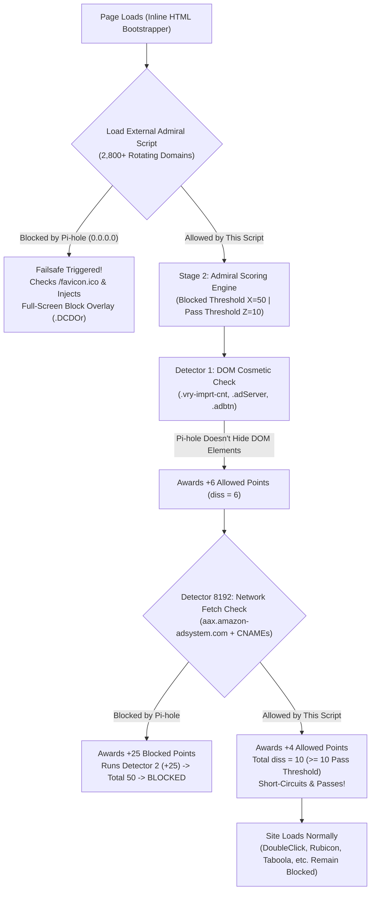

# pihole-admiral-bypass

An automated, zero-maintenance Pi-hole allowlist synchronizer that neutralizes **Admiral** ("Disable your adblocker") walls across news and media sites while keeping actual display and video ads blocked at the DNS layer.

Supports **Pi-hole v6** (via native *Subscribed Allowlists / Antigravity* using `@@||domain^` subdomain wildcards) and automatically falls back to batch SQLite `domainlist` syncing on **Pi-hole v5**.

---

## Why Pi-hole Triggers Admiral Adblock Walls

Unlike browser extensions (such as uBlock Origin), which can strip inline `<script>` tags and hide DOM elements inside the browser, Pi-hole operates purely at the DNS layer.

Publishers using **Admiral** (such as TEGNA, McClatchy, Gannett, and Lee Enterprises news stations) use a **two-stage detection architecture** specifically designed to catch DNS sinkholes when community blocklists block Admiral's domains:



### Stage 1: The Inline HTML Failsafe
1. The publisher embeds an obfuscated inline `<script>` directly in the page's HTML (served from the first-party domain, so Pi-hole cannot block it).
2. That inline script attempts to load Admiral's external detector script from one of **2,800+ rotating domains** (e.g., `woodstockcustom.com`, `succeedscene.com`, etc.).
3. Standard Pi-hole blocklists (AdGuard DNS Filter, Hagezi, StevenBlack, Firebog) pull from EasyPrivacy's Admiral list and **block** those rotating domains.
4. When all script load attempts fail and a `/favicon.ico` check confirms the user is online, the inline script immediately executes its hard-coded failsafe (`H()`) and injects the full-screen white overlay (`<div class="DCDOr">`):
   > *"Something went wrong. Disable your adblocker..."*

### Stage 2: The Two-Counter Scoring Engine (`adbs` vs. `diss`)
Simply whitelisting the rotating Admiral domain in Pi-hole is not enough on its own. Once the external Admiral script loads, it runs a two-counter scoring engine:
* **`adbs` (Adblocker Blocked Score — Threshold `X = 50`):** `hasAdBlocker()` becomes `true` when `adbs >= 50`.
* **`diss` (Adblocker Disabled/Allowed Score — Threshold `Z = 10`):** `hasDisabledAdBlocker()` becomes `true` when `diss >= 10`.
* **Final Block Condition:**
  ```javascript
  blocked = hasAdBlocker() && !hasDisabledAdBlocker()
  ```

Admiral executes **Group 0** (`[Detector 1, Detector 8192]`) first:
1. **Detector `1` (DOM Cosmetic Check):** Injects bait elements (`.vry-imprt-cnt`, `.adServer`, `.adbtn`) and checks if a browser extension hid them via CSS. Because Pi-hole is a DNS sinkhole and never hides DOM elements, this check **always passes** for Pi-hole users and awards **+6 allowed points** (`diss = 6`, `adbs = 0`).
2. **Detector `8192` (Network Fetch Check):** Performs a `fetch()` to `https://aax.amazon-adsystem.com/e/dtb/bid/...`:
   * **If blocked by Pi-hole:** Awards **+25 blocked points** (`adbs = 25`, `diss = 6`). Because `diss < 10`, Admiral proceeds to Group 1 (**Detector `2`**, testing `dt.adsafeprotected.com` and `insight.adsrvr.org`), which adds another **+25 blocked points** (`adbs = 50 >= 50`) and blocks the page.
   * **If allowed by Pi-hole:** Awards **+4 allowed points** (`diss = 6 + 4 = 10`, `adbs = 0`). Because `diss` reaches the `10`-point threshold (`hasDisabledAdBlocker() === true`), **Admiral short-circuits after Group 0**, skips the remaining detectors, and reports `blocked: false, hasAdBlocker: false`!

Meanwhile, actual ad-serving domains (`securepubads.g.doubleclick.net`, `googlesyndication.com`, `rubiconproject.com`, `adsrvr.org`, `adsafeprotected.com`, `taboola.com`, `criteo.net`, etc.) **remain 100% blocked by Pi-hole**.

---

## How This Script Automates Everything Long-Term

1. **Inverts the Upstream Admiral Blocklists into an Allowlist (~2,880+ Domains):**
   Pulls and merges both community-maintained Admiral domain lists that blocklists use:
   * [EasyPrivacy Master Admiral List](https://raw.githubusercontent.com/easylist/easylist/master/easyprivacy/easyprivacy_trackingservers_admiral.txt) (~2,785+ domains)
   * [LanikSJ / uBO GetAdmiral Domains List](https://raw.githubusercontent.com/LanikSJ/ubo-filters/main/filters/getadmiral-domains.txt) (~1,667+ domains)
   Whenever Admiral rotates to a new domain and filter maintainers add it to EasyPrivacy/uBO, your Pi-hole automatically allows it.
2. **Dynamic CNAME Resolution for `aax.amazon-adsystem.com`:**
   Pi-hole performs **CNAME deep inspection**—if any CNAME hop resolves to a blocked domain, Pi-hole blocks the request. Because `aax.amazon-adsystem.com` resolves through a 3-hop CloudFront CNAME chain (`aax-dtb-cf.amazon-adsystem.com` $\rightarrow$ `aax-dtb-cf.amazon-adsystem.amazon.com` $\rightarrow$ `*.cloudfront.net`), this script queries public DNS (`1.1.1.1` / `9.9.9.9`) on every run to dynamically discover and allow the current CNAME chain.
3. **Differential Updates (`cmp -s`) & Safety Guards:**
   Runs once daily via `/etc/cron.daily/pihole-admiral-allowlist`. It verifies that at least 500 valid domains were parsed before touching `/etc/pihole/admiral-allowlist.txt` and **only** reloads Pi-hole (`pihole -g`) when the domain list actually changes.

---

## Installation

### One-Line Install (Run on Your Pi-hole Host)

```bash
curl -fsSL https://raw.githubusercontent.com/dapnepep/pihole-admiral-bypass/main/install.sh | sudo bash
```

### Or Clone and Install Manually

```bash
git clone https://github.com/dapnepep/pihole-admiral-bypass.git
cd pihole-admiral-bypass
sudo bash install.sh
```

---

## Verification

After running the installer on your Pi-hole, verify that the Admiral script domains and Stage-2 bait domain resolve to real IPs while ad servers still resolve to `0.0.0.0`:

```bash
for d in woodstockcustom.com succeedscene.com aax.amazon-adsystem.com securepubads.g.doubleclick.net; do
  printf "%-32s -> %s\n" "$d" "$(dig +short "$d" | tr '\n' ' ')"
done
```

Expected output:
```text
woodstockcustom.com              -> 34.49.36.125
succeedscene.com                 -> 104.18.11.50 104.18.10.50
aax.amazon-adsystem.com          -> aax-dtb-cf.amazon-adsystem.com. ... 52.85.133.77
securepubads.g.doubleclick.net   -> 0.0.0.0
```

---

## Maintenance & Uninstallation

* **Force a manual sync anytime:**
  ```bash
  sudo /usr/local/sbin/update-pihole-admiral-allowlist
  ```
* **View daily cron logs:**
  ```bash
  cat /var/log/pihole-admiral-allowlist.log
  ```
* **Add custom Stage-2 bait domains (if needed in the future):**
  Edit the `BAIT_DOMAINS` array in `/usr/local/sbin/update-pihole-admiral-allowlist`.
* **Uninstall cleanly:**
  ```bash
  sudo bash install.sh --uninstall
  ```

---

## License

[MIT](LICENSE)
