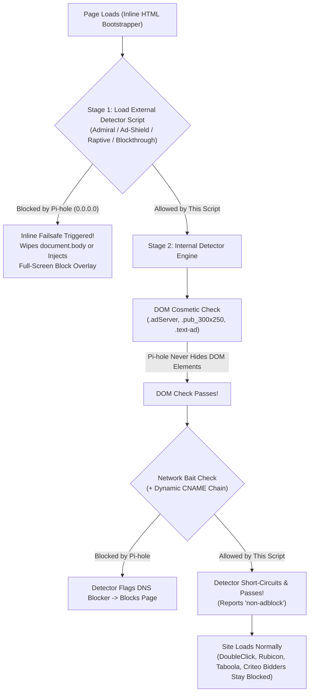

# pihole-adblockerblocker-blocker

An automated, zero-maintenance Pi-hole allowlist synchronizer that neutralizes "adblocker-blocker" walls across news, recipe, streaming, and utility sites while keeping actual display and video ads blocked at the DNS layer.

Covers the major enterprise anti-adblock, adblock-recovery, and ad-stack verification providers:
* **Admiral** (`getadmiral.com` + 2,800+ rotating domains)
* **Ad-Shield** (`html-load.com` / `content-loader.com` + EasyList rotating domains)
* **Raptive / AdThrive** (`ads.adthrive.com` `__adblocker` cookie gatekeeper)
* **Clean.io / HUMAN** (`cadmus.script.ac` anti-malvertising guard)
* **Blockthrough** (`btloader.com` + `ab.dns-finder.com` DNS sinkhole canary)
* **Sourcepoint CMP** (`cdn.privacy-mgmt.com`) & **Google IMA Video SDK** (`imasdk.googleapis.com`)

Supports **Pi-hole v6** (via native *Subscribed Allowlists / Antigravity* using `@@||domain^` subdomain wildcards) and automatically falls back to batch SQLite `domainlist` syncing on **Pi-hole v5**.

---

## Why Pi-hole Triggers Anti-Adblock Walls (And How This Script Defuses Them)

Unlike browser extensions (such as uBlock Origin), which can strip inline `<script>` tags and hide DOM elements inside the browser, Pi-hole operates purely at the DNS layer. Anti-adblock providers exploit this using a **two-stage architecture**:
1. **Stage 1 (Inline HTML Failsafe):** An inline `<script>` embedded directly in the publisher's HTML tries to load an external detector script. If Pi-hole blocks that external domain (`0.0.0.0`), the inline `onerror` handler immediately locks or wipes the page.
2. **Stage 2 (Internal Bait Checks):** Once the external detector script loads, it combines a **DOM cosmetic check** (which always passes on Pi-hole because DNS sinkholes don't hide HTML elements) with **1–2 specific network bait checks** (and their CNAME chains).

By allowing the Stage-1 loader domains and the specific Stage-2 bait endpoints (plus dynamically resolving their live CNAME chains), the detector scripts conclude no adblocker is active and exit cleanly—while actual ad exchanges and ad servers (`securepubads.g.doubleclick.net`, `googleads.g.doubleclick.net`, `rubiconproject.com`, `adsrvr.org`, `adsafeprotected.com`, `taboola.com`, `bidder.criteo.com`, etc.) **remain 100% blocked by Pi-hole**.



---

## Provider-by-Provider Breakdown

### 1. Admiral (`getadmiral.com` — News & Media Publishers)
Used across TEGNA, McClatchy, Gannett, Lee Enterprises, and hundreds of news stations.
* **Stage 1:** Inline script loads an external script from one of **2,800+ rotating domains** (e.g., `woodstockcustom.com`, `succeedscene.com`). If DNS-blocked, it checks `/favicon.ico` and injects `<div class="DCDOr">` (*"Disable your adblocker"*).
* **Stage 2:** Runs a two-counter scoring engine (`adbs >= 50` blocked threshold vs. `diss >= 10` allowed threshold; `blocked = hasAdBlocker() && !hasDisabledAdBlocker()`).
  * **Detector `1` (DOM check):** Passes on Pi-hole, awarding **+6 allowed points** (`diss = 6`).
  * **Detector `8192` (`aax.amazon-adsystem.com`):** Allowing `aax.amazon-adsystem.com` (and its 3-hop CloudFront CNAME chain) awards **+4 allowed points** (`diss = 6 + 4 = 10`), reaching the `10`-point threshold (`hasDisabledAdBlocker() === true`) and causing Admiral to **short-circuit after Group 0**!

### 2. Raptive / AdThrive (`ads.adthrive.com` — Recipe & Lifestyle Sites)
Used across thousands of food, recipe, and lifestyle blogs (often paired with Ad-Shield).
* **Stage 1 (`__adblocker` Cookie Gatekeeper):** An inline script sends an XHR to `https://ads.adthrive.com/abd/abd.js`. If blocked by Pi-hole, the XHR fails (`status = 0`) and sets a first-party cookie `__adblocker=true`, which triggers `<script id="rtv-6f0a">` to inject Ad-Shield (`html-load.com`).
* **Stage 2:** When `ads.adthrive.com` and its sole network bait `pagead2.googlesyndication.com` (`/pagead/js/adsbygoogle.js`) are allowed, `abd.js` sets **`__adblocker=false`**, and `rtv-6f0a` exits immediately **without ever injecting Ad-Shield**. Meanwhile, Raptive's actual ad server (`securepubads.g.doubleclick.net`) stays blocked.

### 3. Ad-Shield (`html-load.com` / `content-loader.com` — Standalone & Raptive)
Used on utility, wiki, gaming, and news sites (`freeconvert.com`, `calculatorsoup.com`, `cookieandkate.com`, `plainchicken.com`, `themediterraneandish.com`, `bild.de`, `indiatimes.com`, etc.).
* **Stage 1:** Inline script loads `bundle.js` from `html-load.com`, `content-loader.com`, `cod.pleasantmelon.pro`, or rotating `.xyz`/`.com` domains. If DNS-blocked, the inline `onerror` handler runs `setInterval(() => document.body.remove(), 100)` and displays `https://report.error-report.com/modal`.
* **Stage 2:** Once `bundle.js` loads, its `AdBlockDetector` checks `pagead2.googlesyndication.com` (`/pagead/js/adsbygoogle.js`) and `static.criteo.net` (`/js/ld/publishertag.prebid.js`). When both resolve (including `static.criteo.net`'s CNAME target), `AdBlockDetector` returns `{isDetected: false, circumventScore: 0}` (`reason: "non-adblock", shouldLoad: false`) and **skips loading the recovery script**—while Criteo's actual ad bidders (`bidder.criteo.com`, `gum.criteo.com`) stay blocked.

### 4. Clean.io / HUMAN (`cadmus.script.ac`)
An anti-malvertising security script (not an ad server) loaded from `cadmus.script.ac`. Some blocklists block `cadmus.script.ac` because it wraps `window.fetch`; on publishers whose ad stack verifies Clean.io initialization, blocking it triggers fallback walls. Allowing `cadmus.script.ac` never serves ads and prevents false-positive lockouts.

### 5. Blockthrough (`btloader.com` / `dns-finder.com` / `ad-delivery.net`)
Detects DNS sinkholes by comparing `wb.dns-finder.com/meta/dns` (unblocked control) against `ab.dns-finder.com/meta/dns` (blocked canary) and `ad-delivery.net/px.gif`. Allowing `btloader.com`, `ab.dns-finder.com`, `wb.dns-finder.com`, and `ad-delivery.net` (while keeping `btmessage.com` and ad exchanges blocked) neutralizes the DNS sinkhole check.

### 6. Sourcepoint CMP (`cdn.privacy-mgmt.com`) & Google IMA SDK (`imasdk.googleapis.com`)
Ensures GDPR/CCPA consent wrappers don't freeze page scrolling and news/streaming video players initialize cleanly before skipping blocked `doubleclick.net` video pre-rolls.

---

## How This Script Automates Everything Long-Term

1. **Pulls & Inverts Upstream Rotating Domain Lists (~2,960+ Domains):**
   Automatically fetches and merges:
   * [EasyPrivacy Master Admiral List](https://raw.githubusercontent.com/easylist/easylist/master/easyprivacy/easyprivacy_trackingservers_admiral.txt) (~2,785+ domains)
   * [LanikSJ / uBO GetAdmiral Domains List](https://raw.githubusercontent.com/LanikSJ/ubo-filters/main/filters/getadmiral-domains.txt) (~1,667+ domains)
   * [EasyList Ad-Shield Rotating Domains](https://raw.githubusercontent.com/easylist/easylist/master/easylist/easylist_adservers.txt) (`! ad-shield` sections)
2. **Dynamic CNAME Chain Resolution:**
   Queries public DNS (`1.1.1.1` / `9.9.9.9`) on every run to discover and allow the live CNAME chains behind every Stage-2 bait domain (such as `aax.amazon-adsystem.com` $\rightarrow$ `*.cloudfront.net` and `static.criteo.net` $\rightarrow$ `*.vip.prod.criteo.com`), so Pi-hole's CNAME deep inspection never trips even when CDN hashes change.
3. **Differential Updates (`cmp -s`) & Safety Guards:**
   Runs once daily via `/etc/cron.daily/pihole-admiral-allowlist`. It verifies that at least 500 valid domains were parsed before touching `/etc/pihole/admiral-allowlist.txt` and **only** reloads Pi-hole (`pihole -g`) when the domain list actually changes.

---

## Installation

### One-Line Install (Run on Your Pi-hole Host)

```bash
curl -fsSL https://raw.githubusercontent.com/dapnepep/pihole-adblockerblocker-blocker/main/install.sh | sudo bash
```

### Or Clone and Install Manually

```bash
git clone https://github.com/dapnepep/pihole-adblockerblocker-blocker.git
cd pihole-adblockerblocker-blocker
sudo bash install.sh
```

---

## Verification

After running the installer on your Pi-hole, verify that the anti-adblock loader and bait domains resolve to real IPs while ad servers still resolve to `0.0.0.0`:

```bash
for d in woodstockcustom.com html-load.com aax.amazon-adsystem.com ads.adthrive.com pagead2.googlesyndication.com static.criteo.net securepubads.g.doubleclick.net; do
  printf "%-32s -> %s\n" "$d" "$(dig +short "$d" | tr '\n' ' ')"
done
```

---

## Maintenance & Uninstallation

* **Force a manual sync anytime:**
  ```bash
  sudo /usr/local/sbin/update-pihole-admiral-allowlist
  ```
* **View daily cron logs:**
  ```bash
  cat /var/log/pihole-admiral-allowlist.log
  ```
* **Uninstall cleanly:**
  ```bash
  sudo bash install.sh --uninstall
  ```

---

## License

[MIT](LICENSE)
